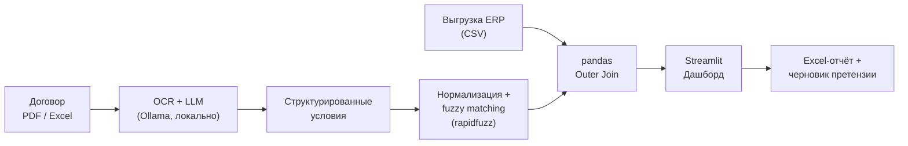

# Проектирование (Design): техническое решение

## Архитектура

> Если Mermaid недоступен в вашем рендерере, замените блок выше
> на изображение assets/architecture.png или на маркированный
> список потоков данных (см. README).

## Выбор технологий

| Слой | Выбор | Обоснование |
|---|---|---|
| OCR | Tesseract (осн.), PaddleOCR (рез.) | docket-idp: несколько бэкендов |
| LLM | Ollama (локально) | данные в контуре компании |
| Разбор | docket-idp | ссылки на источник, валидация |
| Fuzzy | rapidfuzz | token_sort_ratio, WRatio |
| Данные | pandas | outer join, допуск |
| UI | Streamlit | быстрый прототип |
| Отчёты | xlsxwriter / openpyxl | несколько листов Excel |

## Ключевой процесс

1. Ввод документов: PDF-договор + Excel-приложение.
2. Извлечение текста: PDF-слой → OCR → vision-откат.
3. Извлечение полей: LLM по Pydantic-схеме,
   каждое поле со ссылкой на источник.
4. Валидация: разумность чисел, порядок дат,
   монотонность порогов → needs_review.
5. Нормализация + rapidfuzz.
6. Сверка: pandas outer join + допуск.
7. Вывод: Streamlit → Excel → претензия.

## Конфиденциальность и развёртывание LLM

- Модель по умолчанию — Ollama в контуре компании
  (on-premise или закрытое облако).
- Внешний OpenAI-compatible API — только по письменному
  согласованию службы ИБ и с обезличиванием данных.
- Тексты договоров не покидают периметр компании.
- Логи инференса — без содержимого документов.
- Аудит: id документа, версия модели, длительность, статус.
- Обезличивание: плейсхолдеры вместо реквизитов
  перед отправкой во внешний API.

## Риски и их снижение

| Риск | Снижение |
|---|---|
| Плохой OCR сканов | vision-откат + needs_review |
| Разные формулировки условий | JSON Schema + ссылки |
| Нефиксированные заголовки Excel | обнаружение + подтверждение |
| НДС / без НДС | currency + tax_included |
| Ложные missing_* | нормализация + rapidfuzz |
| Утечка коммерческой тайны | только локальный Ollama |
| Короткие наименования | token_sort + ИНН/код товара |
## План миграции после PoC

| Этап | UI | API | Комментарий |
|---|---|---|---|
| PoC | Streamlit | in-process | Быстрый прототип |
| MVP | Streamlit | FastAPI (отдельно) | Разделение UI и логики |
| Prod | React / Next.js | FastAPI | Готовность к нагрузке |

**Принцип**: вся бизнес-логика (extraction, reconciliation,
reporting) выносится в src/ как чистые модули без зависимостей
от Streamlit. UI — тонкая обёртка. Это позволяет заменить
Streamlit на React без переписывания логики.

### Интеграция с docket

1. `register_bonus_schema()` — SchemaSpec с cited_fields.
2. `build_process_options()` — OcrOptions + ReviewOptions +
   OllamaBackend.
3. `process_document(source, options)` -> DocumentResult.
4. `result.document` -> BonusTerms (типизированная схема).
5. `result.field_sources` -> SourceLocation по каждому полю.
6. `result.needs_review` -> очередь проверки.
7. `result.highlights()` -> боксы для UI.
